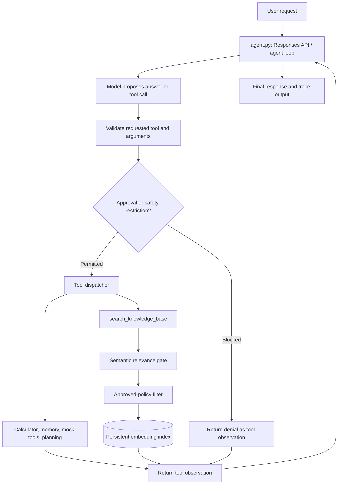

# Smart-Lisa

**Learn AI agent engineering from first principles — one mechanism at a time.**

Smart-Lisa is an educational Python project built to understand **how an AI agent works underneath the frameworks**. It began as a simple LLM call and evolved through function calling, memory, planning, observability, retrieval-augmented generation (RAG), evaluation, and safety controls.

The project uses a **fictional payment-operations knowledge base** to make engineering decisions concrete: What happens after a provider timeout? When should an agent decline to answer? What makes a document authoritative? Who is permitted to execute a financial action?

> [!IMPORTANT]
> **Learning project, not production software.** Smart-Lisa is a reference implementation for experimentation. AtlasPay and its policies are fictional. Payment, pricing, and shipping examples are simulated. No real financial transactions should be connected to this application as-is.

## Why this project exists

A capable model is not automatically a reliable agent. The model can interpret a request and propose the next action, but the surrounding application is responsible for supplying evidence, executing tools, enforcing permissions, recording state, and detecting failures.

A useful mental model is an **F1 team**: the model supplies the intelligence, the agent loop adapts to observations, tools execute the work, telemetry exposes performance, and governance determines what is permitted. A fast car alone does not win a race.

Smart-Lisa deliberately implements individual mechanisms before adopting a high-level agent SDK, so readers can inspect the contracts and failure modes rather than only learn framework APIs.

## What is implemented

| Learning area | Mechanism | Where to explore |
| --- | --- | --- |
| LLM interaction | OpenAI Responses API, multi-turn response chaining | `agent.py`, `llm_interface.py` |
| Function calling | Tool schemas, registry, dispatch, argument validation | `agent.py` |
| State and memory | JSON-backed `remember` / `recall` tools | `agent.py`; runtime-created `memory.json` |
| Planning | `record_plan` tool and planning instructions | `agent.py` |
| Human oversight | Approval prompt and separate payment-action blocking | `agent.py`, `trusted_retrieval.py` |
| Observability | Trace IDs, LLM/tool counts, timings and token usage | `agent.py` |
| Basic retrieval | Keyword matching over local `.txt` documents | `retrieval.py` |
| Semantic retrieval | OpenAI embeddings and cosine similarity | `semantic_retrieval.py`, `cosine_similarity.py` |
| Document processing | Overlapping word-based chunks | `chunking.py` |
| Persistent indexing | SHA-256 change detection, embedding reuse, atomic index replacement | `persistent_index.py` |
| Hybrid search | Keyword + semantic ranking with reciprocal rank fusion | `hybrid_retrieval.py` |
| Relevance filtering | Similarity gate and explicit `NO_EVIDENCE` result | `relevance_gate.py` |
| Context recovery | Neighboring-chunk expansion | `chunk_expansion.py` |
| Source authority | Approved-policy filtering and duplicate-approval detection | `trusted_retrieval.py`, `policy_registry.json` |
| RAG evaluation | Retrieval metrics, answer assertions, reliability report | `rag_evaluator.py`, `rag_answer_evaluator.py`, `rag_reliability_report.py` |
| Safety exercises | Simulated action denial, malicious-document fixture, offline tests | `trusted_retrieval.py`, `adversarial_knowledge/`, `test_trusted_retrieval.py` |

**Important architectural distinction:** these modules represent the learning progression; **not all experiments are composed into the live agent**. In the current snapshot, `search_knowledge_base()` uses the trusted, semantic **relevance gate**. Hybrid search and neighboring-chunk expansion are separate exercises that can be run independently.

## How the running agent works



The model can *request* work. Python code decides what to execute. The `send_payment` capability is **blocked by the current live dispatcher**, even if the interactive approval prompt is accepted; it must not be interpreted as a functioning payment-approval system.

The policy retrieval path uses `policy_registry.json` to exclude sources not marked `approved` and to reject duplicate approved versions of the same policy ID. The relevance gate returns `NO_EVIDENCE` when no candidate reaches its current similarity threshold.

## Quick start

### Requirements

- Python **3.12 or newer** (`pyproject.toml` requirement).
- [`uv`](https://docs.astral.sh/uv/) for dependency and environment management.
- An OpenAI API key with access to the configured models, and API credits for model and embedding calls.

### 1. Clone or unpack the project

```bash
cd smart-lisa
```

### 2. Install dependencies

```bash
uv sync
```

The current `pyproject.toml` declares `openai` and `dotenv` as its external dependencies. `uv.lock` is included for reproducible resolution.

### 3. Supply credentials locally

Create a `.env` file **in the project root**:

```dotenv
OPENAI_API_KEY=your_openai_api_key_here
```

Do not commit `.env`, credentials, personal memory, or confidential documents. The running agent's model is currently configured in `agent.py`, and the embedding model (`text-embedding-3-small`) is set in the retrieval/indexing modules. Change the model configuration if it is not available to your account.

### 4. Prepare the knowledge index

The example archive contains an `embedding_index.json` created during learning. To rebuild the index for the current contents of `knowledge/`, run:

```bash
uv run python persistent_index.py
```

The script prints counts for newly generated embeddings, reused embeddings, and total chunks. **New or changed chunks trigger embedding API calls and may incur charges.** The cache reuses embeddings where the chunk content hash and embedding model still match.

### 5. Start the interactive agent

```bash
uv run python agent.py
```

Try these prompts, one at a time:

```text
What happens when a payment provider times out?
How do we prevent duplicate refunds?
What is AtlasPay's maternity leave policy?
Remember that my learning project is Smart-Lisa.
What is my learning project?
Calculate 125 multiplied by 8.
```

Type `exit` or `quit` to end the session. The interactive prototype also contains a small hard-coded conversation-turn limit; restart it for a fresh session when that limit is reached.

**What to look for:** a relevant policy query should trigger knowledge search and source-backed explanation; a question outside the available policies should lead to an explicit inability to verify it; tool use should produce trace events.

## Explore the mechanisms separately

The repository deliberately keeps several experiments runnable in isolation:

```bash
# Start with basic lexical matching and chunking
uv run python retrieval.py
uv run python chunking.py

# Explore embedding similarity (uses the OpenAI API)
uv run python semantic_retrieval.py

# Compare retrieval strategies and inspect hybrid ranking
uv run python hybrid_retrieval.py

# Evaluate the relevance gate (uses the OpenAI API)
uv run python relevance_gate.py

# Expand neighboring chunks around selected retrieval results
uv run python chunk_expansion.py

# Inspect approved document filtering and safety demonstrations
uv run python trusted_retrieval.py
```

Some examples require a generated index and API access. The scripts are teaching exercises, not stable command-line interfaces.

### Test the fundamentals offline

```bash
uv run python -m unittest -v test_trusted_retrieval.py
```

The five included tests use a mocked OpenAI client and the sample index to check:

1. Retrieval of evidence for a valid payment-policy question.
2. Rejection of an unrelated, out-of-domain query.
3. Exclusion of a superseded policy source.
4. Failure on duplicate approved versions of the same policy ID.
5. Denial of a simulated payment action without independent approval.

These are **focused tests of selected mechanisms**, not an end-to-end certification of the running agent. The tests currently depend on the included embedding index.

### Run evaluation experiments

```bash
# Retrieval Hit@3, mean Recall@3, and MRR@3
uv run python rag_evaluator.py

# Interactive textual checks for manually captured agent answers
uv run python rag_answer_evaluator.py

# Produce a consolidated JSON report
uv run python rag_reliability_report.py
```

The consolidated report writes `rag_reliability_report.json`. Its `NOT_TESTED` fields mean precisely that: those aspects were not exercised by that runner. In particular, simple substring assertions do **not** prove answer faithfulness or citation correctness.

A previous learning run reported **Hit@3 = 1.0, mean Recall@3 = 0.9, MRR@3 = 1.0** on just five answerable questions, alongside three successful out-of-domain abstentions. Treat those as observations from a tiny educational dataset, **not generalizable benchmarks or production SLAs**. Your own results may vary with model/index changes.

## Data and repository layout

```text
smart-lisa/
├── agent.py                     # Interactive agent and tool loop
├── llm_interface.py             # OpenAI client helper
├── retrieval.py                 # Keyword retrieval
├── semantic_retrieval.py        # Embeddings and similarity search
├── cosine_similarity.py         # Similarity exercise
├── chunking.py                  # Overlapping chunks
├── persistent_index.py         # Indexed embeddings / reuse
├── hybrid_retrieval.py          # Keyword + semantic RRF
├── relevance_gate.py            # Evidence/no-evidence decision
├── chunk_expansion.py           # Neighboring context experiment
├── trusted_retrieval.py         # Policy eligibility and safety simulator
├── knowledge/                   # Fictional payment-policy documents
├── adversarial_knowledge/       # Isolated prompt-injection test fixture
├── policy_registry.json         # Example document-status metadata
├── embedding_index.json         # Generated, local vector index
├── rag_eval_dataset.json        # Retrieval golden cases
├── rag_answer_dataset.json      # Textual answer assertions
├── rag_evaluator.py             # Retrieval metrics
├── rag_answer_evaluator.py      # Manual answer check
├── rag_reliability_report.py    # Consolidated report
├── test_trusted_retrieval.py    # Focused offline tests
├── pyproject.toml
└── uv.lock
```

`memory.json` is created at runtime when memory is saved; it is not required to exist initially. The example corpus includes historical and unregistered policies to explore authority filtering. **Do not use the presence of a file in `knowledge/` as proof it is approved.**

## Security and trust model

The project demonstrates several principles, but **does not claim production-grade enforcement**:

- **Evidence is not authority.** Text returned from retrieval is untrusted reference material, not executable instructions.
- **Relevance is not correctness.** A similarity score does not prove a passage answers the question.
- **Document approval is explicit.** Sample metadata controls which indexed chunks the active relevance gate may consider. Approval metadata is manually curated, not cryptographically authenticated.
- **Actions must be independently authorized.** The current agent deliberately blocks its simulated `send_payment` request; the separate safety helper illustrates denial without approval.
- **Unknown is an acceptable result.** Out-of-scope or insufficiently supported questions should be answered with uncertainty rather than invented policy.
- **Test artifacts are not trusted production data.** `adversarial_knowledge/malicious_timeout.txt` is an isolated prompt-injection example, not a document to approve or execute.

The current registry checks approval status and duplicate approved policy IDs. It does **not** implement all production concerns such as effective-date enforcement, tenant-specific permissions, content signatures, source provenance, regulatory controls, or document-level access policies. Some experimental paths (including neighboring-chunk expansion) use the raw index and must not be treated as protected retrieval interfaces without additional filtering.

**Before publishing or deploying:** inspect all files for real data, secrets, generated memory, traces, and index contents. Embeddings and cached chunks can contain or reveal information derived from private documents. Add a `.gitignore` appropriate to the repository, and do not commit `.env`, `memory.json`, or confidential indexes.

## Current limitations

Smart-Lisa is intentionally small and transparent. Known limitations include:

- The running agent uses the **semantic relevance gate**, not the full hybrid-plus-neighbor-expansion pipeline.
- The similarity threshold is a learning heuristic, not a calibrated assurance guarantee.
- The agent's planning is prompt/tool-driven rather than a durable workflow engine.
- The interactive CLI and agent execution are coupled; `agent.py` starts its loop on import.
- Memory is a local, simple JSON key-value store without per-user separation, atomic writes, or concurrency control.
- Tracing writes primarily to the console, not a centralized audit or observability platform.
- The agent's tool-call counter increments by **tool-response rounds**, not by every requested tool; its limit is not yet a comprehensive execution budget.
- The simulated payment approval UX is deliberately incomplete: the dispatcher blocks payment even after an interactive approval response.
- Some demo utilities have hard-coded values (for example product pricing and shipping).
- Policy conflict detection covers duplicate approved policy identities, **not arbitrary semantic contradictions** between documents.
- Automated faithfulness verification, end-to-end injection testing, real authentication, database durability, and production operational controls are out of scope.

These constraints are part of the educational purpose: they make the next architectural questions visible.

## Learning direction

The from-scratch implementation is intended to serve as a **reference baseline**, not something to discard once a framework is introduced. Future learning can compare it with an agent SDK, richer persistence, MCP-based tool integration, multi-agent orchestration, deeper evaluation, and deployment patterns.

The guiding principle remains:

> **Deterministic correctness does not require deterministic discovery.** A model may help determine the next step; trusted software must enforce business invariants, permission boundaries, and safe execution.

## Contributing, responsible use, and licensing

Learning-focused issues, reproducible tests, clearer contracts, and defensive improvements are welcome. Please do not submit real payment credentials, customer records, or working payment-transfer integrations.

**License:** This snapshot does not include a `LICENSE` file. Before distributing the project for reuse, choose and add a license explicitly. A public repository without an explicit license does not automatically grant permission to reuse or modify its code.

---

*Built as a step-by-step exploration of AI agent fundamentals, with an emphasis on engineering judgment, trust boundaries, and knowing when not to use an agent.*
